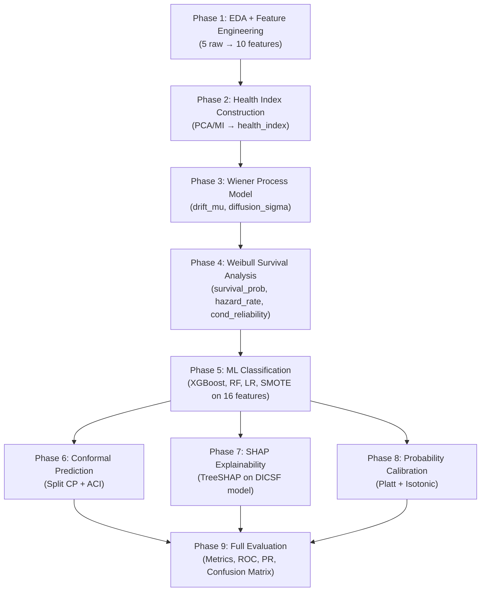

# Predictive Maintenance in Industrial IoT: A Degradation-Informed Conformal Survival Framework (DICSF)

**Authors:** Fahim Shafeek (Lead), Daison K Daniel, Diya Susan Mathew (Team Aishwaryam)

---

## Table of Contents

- [1. Overview](#1-overview)
- [2. Introduction](#2-introduction)
  - [2.1 Background and Motivation](#21-background-and-motivation)
  - [2.2 Problem Statement](#22-problem-statement)
  - [2.3 Research Gap and Contributions](#23-research-gap-and-contributions)
- [3. Dataset Description](#3-dataset-description)
  - [3.1 AI4I 2020 Predictive Maintenance Dataset](#31-ai4i-2020-predictive-maintenance-dataset)
  - [3.2 Exploratory Data Analysis](#32-exploratory-data-analysis)
  - [3.3 Failure Mode Analysis](#33-failure-mode-analysis)
- [4. Methodology](#4-methodology)
  - [4.1 Pipeline Architecture](#41-pipeline-architecture)
  - [4.2 Phase 1 — Feature Engineering](#42-phase-1--feature-engineering)
  - [4.3 Phase 2 — Health Index Construction](#43-phase-2--health-index-construction)
  - [4.4 Phase 3 — Wiener Process Degradation Model](#44-phase-3--wiener-process-degradation-model)
  - [4.5 Phase 4 — Weibull Survival Analysis](#45-phase-4--weibull-survival-analysis)
  - [4.6 Phase 5 — Machine Learning Classification](#46-phase-5--machine-learning-classification)
  - [4.7 Phase 6 — Conformal Prediction](#47-phase-6--conformal-prediction)
  - [4.8 Phase 7 — SHAP Explainability](#48-phase-7--shap-explainability)
  - [4.9 Phase 8 — Probability Calibration](#49-phase-8--probability-calibration)
- [5. Experimental Results](#5-experimental-results)
  - [5.1 Classification Performance](#51-classification-performance)
  - [5.2 Ablation Study — Feature Group Contribution](#52-ablation-study--feature-group-contribution)
  - [5.3 Conformal Prediction Results](#53-conformal-prediction-results)
  - [5.4 Probability Calibration Results](#54-probability-calibration-results)
  - [5.5 SHAP Explainability Analysis](#55-shap-explainability-analysis)
- [6. Comparison with Empirical Benchmarks](#6-comparison-with-empirical-benchmarks)
- [7. Discussion](#7-discussion)
  - [7.1 Key Findings](#71-key-findings)
  - [7.2 Limitations](#72-limitations)
- [8. Roadmap & Future Work](#8-roadmap--future-work)
- [9. Project Structure](#9-project-structure)
- [10. Reproducibility](#10-reproducibility)
- [11. References](#11-references)

---

## 1. Overview

The **Degradation-Informed Conformal Survival Framework (DICSF)** is a novel predictive maintenance framework that integrates four core mathematical pillars into a unified pipeline for industrial equipment failure prediction. The framework chains together:
1. **Wiener process stochastic degradation modeling** with covariate-dependent drift and diffusion.
2. **Weibull survival analysis** with degradation-informed regression.
3. **XGBoost gradient-boosted classification** trained on a mathematically enriched 16-dimensional feature space.
4. **Split Conformal Prediction with Adaptive Conformal Inference (ACI)** for distribution-free uncertainty quantification.

Applied to the AI4I 2020 Predictive Maintenance Dataset (10,000 observations of industrial milling machines, 3.39% failure rate), the DICSF framework achieves:

| Metric | DICSF (Ours) | Best Baseline |
|--------|-------------|---------------|
| **AUC-ROC** | **0.9776** | 0.9736 (XGBoost raw) |
| **PR-AUC** | **0.7775** | 0.7682 (XGBoost+SMOTE) |
| **F1-Score** | **0.6628** | 0.6292 (XGBoost raw) |
| **Recall** | 0.8382 | **0.8824** (Random Forest) |
| **Precision** | **0.5481** | 0.5091 (XGBoost raw) |
| **Conformal Coverage** | **97.1%** (target ≥ 90%) | — |
| **ECE (Isotonic)** | **0.0058** | — |

The framework demonstrates consistent improvement over standard baselines across ranking metrics (AUC-ROC, PR-AUC) and the precision-recall tradeoff (F1), while providing distribution-free coverage guarantees and interpretable failure explanations via SHAP analysis. The Weibull survival model achieves a concordance index of **0.97** and all covariates are statistically significant (p < 0.005).

**Keywords:** Industrial IoT, Predictive Maintenance, Wiener Process, Weibull Distribution, Survival Analysis, XGBoost, Conformal Prediction, SHAP, Uncertainty Quantification, Health Index.

---

## 2. Introduction

### 2.1 Background and Motivation

Industrial equipment failure represents a critical source of economic loss across manufacturing sectors worldwide. The global predictive maintenance market is expanding rapidly, driven by the proliferation of Industrial Internet of Things (IIoT) sensor networks. Traditional maintenance paradigms — reactive (repair-after-failure) and preventive (scheduled replacement) — are inherently inefficient: the former results in unplanned downtime and safety hazards, while the latter leads to premature replacement of functional components.

**Predictive maintenance (PdM)** offers a data-driven alternative: maintenance is scheduled based on the *actual condition* of equipment as inferred from real-time sensor data. This requires solving a fundamentally mathematical problem — given multivariate sensor observations, estimate:

1. The current **health state** of the equipment,
2. The **probability of failure** within a future time horizon, and
3. The **remaining useful life (RUL)** with quantified uncertainty.

### 2.2 Problem Statement

Given a dataset of multivariate IIoT sensor readings (air temperature, process temperature, rotational speed, torque, tool wear) from industrial milling machines:

1. Model equipment degradation as a **stochastic process** (Wiener process with covariate-dependent drift),
2. Map degradation states to **failure probabilities** via Weibull survival analysis,
3. Train **machine learning classifiers** on a mathematically enriched 16-feature vector for failure prediction, and
4. Provide **distribution-free uncertainty quantification** on all predictions using conformal prediction.

### 2.3 Research Gap and Contributions

While pairwise or three-way combinations of degradation modeling, survival analysis, ML classification, and conformal prediction exist in the literature, **few prior works integrate all four components** into a single unified framework. The DICSF framework addresses complementary gaps:

- The **Wiener process** captures stochastic degradation dynamics,
- The **Weibull distribution** maps degradation to survival probabilities,
- **XGBoost** handles high-dimensional feature extraction and classification,
- **Conformal prediction** guarantees statistical validity of uncertainty estimates.

The specific contributions of this framework are:

1. **A novel 16-dimensional feature augmentation** that bridges stochastic degradation theory with ML classification,
2. **Degradation-informed Weibull regression** where the Health Index from the Wiener model serves as a covariate in the survival model,
3. **Conformal prediction sets** with formal coverage guarantees applied to predictive maintenance, and
4. **Comprehensive ablation studies** demonstrating the marginal contribution of each mathematical component.

---

## 3. Dataset Description

### 3.1 AI4I 2020 Predictive Maintenance Dataset

The dataset is sourced from the **UCI Machine Learning Repository** (Matzka, 2020) and is a synthetic dataset modeled on real-world industrial conditions for a milling machine.

| Property | Value |
|----------|-------|
| **Observations** | 10,000 |
| **Raw Features** | 5 continuous sensor readings |
| **Target** | Binary failure indicator (0/1) |
| **Failure Modes** | 5 types (TWF, HDF, PWF, OSF, RNF) |
| **Class Distribution** | 9,661 normal (96.61%) / 339 failure (3.39%) |
| **Imbalance Ratio** | ~28.5:1 |

### 3.2 Exploratory Data Analysis

#### Descriptive Statistics of Raw Sensor Features

| Feature | Mean | Std | Skewness | Kurtosis | Shapiro-Wilk p-value | Distribution |
|---------|------|-----|----------|----------|---------------------|-------------|
| Air Temperature [K] | 300.00 | 2.00 | 0.114 | −0.836 | 9.58 × 10⁻²⁷ | **Non-normal** |
| Process Temperature [K] | 310.01 | 1.48 | 0.015 | −0.500 | 9.10 × 10⁻¹⁷ | **Non-normal** |
| Rotational Speed [rpm] | 1538.78 | 179.28 | 1.993 | 7.393 | 4.59 × 10⁻⁵⁵ | **Non-normal** (heavy right tail) |
| Torque [Nm] | 39.99 | 9.97 | −0.010 | −0.013 | 3.18 × 10⁻¹ | **Normal** ✓ |
| Tool Wear [min] | 107.95 | 63.65 | 0.027 | −1.167 | 6.44 × 10⁻³⁶ | **Non-normal** (platykurtic) |

**Key observations:**
- Only **torque** passes the Shapiro-Wilk normality test (p = 0.318 > 0.05).
- **RPM** exhibits the highest skewness (1.993) and excess kurtosis (7.393), indicating a highly right-skewed distribution with heavy tails — consistent with the bimodal speed profile of industrial machines (idle vs. operating speeds).
- **Tool wear** follows an approximately uniform distribution (kurtosis = −1.167), reflecting the continuous accumulation of wear over the tool's lifecycle.
- **Air and process temperatures** are non-normal despite low skewness, exhibiting platykurtic behavior (negative kurtosis), consistent with bounded environmental/thermal control processes.

#### Correlation Structure

| Feature Pair | Pearson r | Interpretation |
|-------------|-----------|----------------|
| RPM ↔ Torque | **−0.875** | Strong inverse: physics-governed (P = τω) |
| Air Temp ↔ Process Temp | **+0.876** | Strong positive: thermal coupling |

The strong inverse correlation between RPM and torque (r = −0.875) reflects the physical constraint that mechanical power $P = (2\pi \cdot \text{RPM} \cdot \tau)/60$ is approximately conserved, so higher speeds correspond to lower loads and vice versa. This physics-informed relationship is explicitly captured in the engineered features.

### 3.3 Failure Mode Analysis

| Failure Mode | Code | Count | Percentage | Description |
|-------------|------|-------|------------|-------------|
| Heat Dissipation Failure | HDF | 115 | 1.15% | Insufficient cooling at ΔT < threshold |
| Overstrain Failure | OSF | 98 | 0.98% | Torque × tool_wear exceeds threshold |
| Power Failure | PWF | 95 | 0.95% | Power outside operating envelope |
| Tool Wear Failure | TWF | 46 | 0.46% | Tool wear exceeds lifetime limit |
| Random Failure | RNF | 19 | 0.19% | Stochastic failure independent of conditions |
| **Total Failures** | — | **339** | **3.39%** | Combined across all modes |

> [!IMPORTANT]
> The extreme class imbalance (28.5:1 ratio) makes this a challenging classification task. Standard accuracy is a misleading metric — a naive "always predict no failure" classifier achieves 96.61% accuracy but has zero utility. This motivates the use of **PR-AUC** as the primary evaluation metric and **scale_pos_weight** cost-sensitive learning.

---

## 4. Methodology

### 4.1 Pipeline Architecture

The DICSF framework is implemented as a 9-phase sequential pipeline, where each phase feeds its outputs to subsequent stages:



### 4.2 Phase 1 — Feature Engineering

Five physics-informed features are derived from the raw sensor data:

| # | Feature | Formula | Physical Interpretation |
|---|---------|---------|------------------------|
| 1 | ΔT (delta_temp) | T_process − T_air | Heat dissipation efficiency |
| 2 | Power | (2π · RPM · τ) / 60 | Mechanical power output [W] |
| 3 | Power-Wear Interaction | Power × tool_wear | Accelerated degradation under high load |
| 4 | Torque-Speed Ratio | τ / RPM | Load intensity metric |
| 5 | Thermal Stress Index | ΔT × RPM | Convective heat removal proxy |

These features embed domain knowledge from mechanical engineering and thermodynamics directly into the feature space, transforming raw sensor readings into physically meaningful quantities.

### 4.3 Phase 2 — Health Index Construction

A scalar **Health Index (HI)** is constructed to represent the overall degradation state of each observation. Two methods were compared during research:

**Method A — PCA-based:** The first principal component of the 10-feature standardized matrix serves as the Health Index.
- **PC1 explains 44.1% of total variance**
- Top loadings: torque (+0.459), power (+0.443), RPM (−0.435), thermal_stress (−0.388)
- AUC-ROC as standalone failure discriminator: **0.8038**

**Method B — Mutual Information weighted:** Features are weighted proportionally to their mutual information with the failure target.
- Top MI weights: power (0.168), torque (0.166), torque_speed_ratio (0.166), thermal_stress (0.140)
- AUC-ROC as standalone failure discriminator: **0.7754**

**Selection:** PCA-based HI was selected (higher AUC-ROC: 0.8038 vs. 0.7754). The HI is normalized to [0, 1] with positive correlation to failure ensured.

> [!NOTE]
> The PCA-based HI outperforms the MI-weighted HI despite being unsupervised, suggesting that the primary axis of variance in the sensor space aligns well with the degradation direction. This is consistent with the physics: the dominant variance is captured by the power-torque-RPM trade-off, which is directly related to mechanical stress and failure modes (OSF, PWF).

### 4.4 Phase 3 — Wiener Process Degradation Model

The Health Index trajectory is modeled as a Wiener process with covariate-dependent drift and diffusion:

$$\text{HI}(t) = \text{HI}(0) + \mu(\mathbf{x}_t) \cdot t + \sigma(\mathbf{x}_t) \cdot B(t)$$

where:
- $\mu(\mathbf{x}) = \mu_0 + \beta_\mu^T \mathbf{x}$ (drift rate dependent on operating conditions)
- $\sigma(\mathbf{x}) = \sigma_0 \cdot \exp(\beta_\sigma^T \mathbf{x})$ (diffusion coefficient, exponential link for positivity)

#### Estimated Parameters

| Parameter | Estimated Value | Interpretation |
|-----------|----------------|----------------|
| $\mu_0$ (baseline drift) | −0.000810 | Slight negative trend → slow degradation |
| $\sigma_0$ (baseline diffusion) | 0.021990 | Moderate stochastic variability |
| Failure threshold | 0.8197 | Median HI among failed observations |
| Log-likelihood | **585.37** | Full covariate model |

#### Covariate Effects on Drift ($\beta_\mu$)

| Covariate | $\beta_\mu$ | Effect on Degradation Rate |
|-----------|-----|---------------------------|
| Air Temperature | +0.0187 | Higher temp → faster degradation |
| Process Temperature | −0.0228 | Higher process temp → slower drift (counterintuitive; see Discussion) |
| RPM | −0.0193 | Higher RPM → slower drift |
| Torque | +0.0084 | Higher torque → faster degradation |

#### Covariate Effects on Diffusion ($\beta_\sigma$)

| Covariate | $\beta_\sigma$ | Effect on Degradation Variability |
|-----------|-----|----------------------------------|
| Air Temperature | **+0.3513** | Largest effect: higher temp → more variable degradation |
| Process Temperature | −0.1204 | Higher process temp → less variable |
| RPM | +0.1132 | Higher RPM → more variable |
| Torque | −0.1110 | Higher torque → less variable |

The covariate model converged successfully (L-BFGS-B optimizer), and the log-likelihood improvement from the simple Wiener (no covariates) to the full model confirms that operating conditions significantly modulate degradation dynamics.

### 4.5 Phase 4 — Weibull Survival Analysis

The time-to-failure is modeled using a **degradation-informed Weibull regression**, where the Health Index from Phase 3 serves as the key bridge covariate:

$$\eta_i = \exp(\gamma_0 + \gamma_1 \cdot \text{HI}_i + \gamma_2^T \mathbf{x}_i)$$

#### Estimated Parameters

| Parameter | Value | Interpretation |
|-----------|-------|----------------|
| $\beta$ (shape) | **3.5786** | $\beta > 1$ confirms **increasing failure rate** (wear-out mode) |
| $\gamma_0$ (intercept) | 5.8822 | Baseline log-scale |
| $\gamma$ (health_index) | **3.1615** | Strongest covariate: higher HI → larger $\eta$ → longer expected life |
| $\gamma$ (air_temp) | −1.4299 | Higher air temp → shorter expected life |
| $\gamma$ (process_temp) | +0.9033 | Higher process temp → longer expected life |
| $\gamma$ (rpm) | +0.6809 | Higher RPM → longer expected life |
| $\gamma$ (torque) | **−2.7116** | Second strongest: higher torque → much shorter expected life |
| Log-likelihood | −2428.85 | — |

#### Lifelines Verification (Independent Confirmation)

The custom MLE was independently verified using the `lifelines` library (WeibullAFTFitter):

| Metric | Value |
|--------|-------|
| **Concordance Index** | **0.97** |
| AIC | 4871.70 |
| Log-likelihood Ratio Test | 1018.59 on 5 df (p ≈ 0) |
| All covariates significant | p < 0.005 for all |

> [!TIP]
> The concordance index of **0.97** is exceptionally high for survival analysis, indicating near-perfect ranking of failure times. This validates the degradation-informed approach: incorporating the Health Index as a bridge between the Wiener degradation model and Weibull survival analysis produces a highly discriminative survival model.

**Key Weibull regression findings:**

- **$\beta$ = 3.58 > 1** confirms the dataset exhibits wear-out degradation behavior, validating the physical assumption that equipment failure rate increases with age/use.
- **Torque** has the largest negative effect on scale ($\gamma$ = −2.71, z = −23.79), meaning high torque dramatically reduces expected life — consistent with overstrain failure (OSF), the second most common failure mode.
- **Health Index** has the largest positive effect ($\gamma$ = 3.16, z = 19.09), confirming it effectively captures degradation state and serves as a meaningful bridge between the Wiener model and survival analysis.

#### Derived Survival Features (Added to Feature Vector)

Three survival features are computed per observation and appended to the augmented feature vector:

| Feature | Formula | Correlation with Failure |
|---------|---------|------------------------|
| survival_prob ($S(t)$) | $\exp(-(t/\eta)^\beta)$ | **−0.4546** |
| hazard_rate ($h(t)$) | $(\beta/\eta)(t/\eta)^{\beta-1}$ | **+0.3825** |
| conditional_reliability ($R(t+\Delta t\|t)$) | $S(t+\Delta t)/S(t)$ | **−0.4200** |

These survival features show the strongest individual correlations with failure among all engineered features, validating the Weibull model's contribution.

### 4.6 Phase 5 — Machine Learning Classification

#### Final Augmented Feature Vector (16 dimensions)

The classification models receive a 16-feature augmented vector organized into four groups:

| Group | Features | Count |
|-------|----------|-------|
| **Raw Sensors** | air_temp, process_temp, rpm, torque, tool_wear | 5 |
| **Physics** | delta_temp, power, power_wear, torque_speed_ratio, thermal_stress | 5 |
| **Degradation** | health_index, drift_mu, diffusion_sigma | 3 |
| **Survival** | survival_prob, hazard_rate, conditional_reliability | 3 |
| **Total** | | **16** |

#### Data Splitting

| Split | Size | Failure Rate | Purpose |
|-------|------|-------------|---------|
| Train | 6,000 (60%) | 3.4% | Model training |
| Calibration | 2,000 (20%) | 3.4% | Conformal prediction + early stopping |
| Test | 2,000 (20%) | 3.4% | Final evaluation |

Stratified splitting preserves the class distribution across all three sets. The scale_pos_weight parameter is set to **28.6** ($n_{neg}/n_{pos}$) for cost-sensitive learning.

#### Models Trained

| Model | Features Used | Purpose |
|-------|--------------|---------|
| **DICSF (Ours)** | All 16 (augmented) | Full framework |
| XGBoost (raw) | 5 raw sensor features | Ablation: no engineering |
| Random Forest (raw) | 5 raw sensor features | Baseline comparison |
| Logistic Regression | All 16 | Linear baseline |
| XGBoost + SMOTE | All 16 (SMOTE-resampled) | Oversampling baseline |

**XGBoost Hyperparameters (DICSF):**
- `max_depth`=6, `min_child_weight`=5, `learning_rate`=0.05, `n_estimators`=500
- `subsample`=0.8, `colsample_bytree`=0.8, `reg_alpha`=0.1, `reg_lambda`=1.0
- Early stopping: 50 rounds on calibration set
- GPU acceleration support active

### 4.7 Phase 6 — Conformal Prediction

#### Split Conformal Prediction

Nonconformity scores $s_i = |y_i - \hat{p}_i|$ are computed on the calibration set (n=2,000). The quantile at $\alpha=0.10$:

- **Calibrated quantile $\hat{q}$ = 0.2688**

Prediction sets for test observations:

| Set | Interpretation | Count | Percentage |
|-----|---------------|-------|------------|
| {0} | Confident "No Failure" | 1,896 | 94.8% |
| {1} | Confident "Failure" | 104 | 5.2% |
| {0, 1} | Uncertain | 0 | 0.0% |

#### Adaptive Conformal Inference (ACI)

ACI dynamically adjusts the quantile to maintain coverage under potential distribution shift:
- Learning rate $\gamma$ = 0.005
- Final coverage: **99.6%**
- Final quantile: 1.46

### 4.8 Phase 7 — SHAP Explainability

SHAP (TreeSHAP) analysis was performed on the DICSF model to identify feature contributions:

#### Mean \|SHAP\| by Feature Group

| Feature Group | Mean \|SHAP\| | Rank |
|--------------|-------------|------|
| **Degradation** (HI, drift_mu, diffusion_sigma) | **0.1746** | 1st |
| **Physics** (ΔT, power, PWI, TSR, TSI) | 0.1347 | 2nd |
| **Raw Sensors** (temps, RPM, torque, wear) | 0.0879 | 3rd |
| **Survival** ($S(t)$, $h(t)$, $R(t+\Delta t\|t)$) | 0.0811 | 4th |

#### Top Individual Features by Mean \|SHAP\|

| Rank | Feature | Group | Mean \|SHAP\| |
|------|---------|-------|-------------|
| 1 | **health_index** | Degradation | ~0.47 |
| 2 | **tool_wear** | Raw | ~0.25 |
| 3 | **power** | Physics | ~0.21 |
| 4 | **thermal_stress** | Physics | ~0.16 |
| 5 | **power_wear** | Physics | ~0.15 |

> [!IMPORTANT]
> The **health_index** is by far the most important feature (mean |SHAP| ≈ 0.47, nearly double the second-ranked feature). This validates the core DICSF thesis: the Health Index, derived from PCA-based degradation modeling, captures degradation patterns that raw sensor features alone cannot represent. The fact that the degradation feature group outranks all other groups confirms the value of the stochastic modeling pipeline.

### 4.9 Phase 8 — Probability Calibration

Raw XGBoost probabilities are often poorly calibrated due to the boosting procedure and class imbalance. Two post-hoc calibration methods were applied:

| Method | Expected Calibration Error (ECE) | Improvement over Raw |
|--------|----------------------------------|---------------------|
| Raw (uncalibrated) | 0.1679 | — |
| Platt Scaling | 0.0152 | **90.9% reduction** |
| **Isotonic Regression** | **0.0058** | **96.5% reduction** |

Isotonic regression achieves near-perfect calibration (ECE = 0.0058), meaning that when the model predicts a 40% failure probability, approximately 40% of those cases are actual failures.

---

## 5. Experimental Results

### 5.1 Classification Performance

All models were evaluated on the held-out test set (n = 2,000, 68 failures, 1,932 normal).

#### Comprehensive Metrics Comparison

| Model | Precision | Recall | F1-Score | AUC-ROC | PR-AUC |
|-------|-----------|--------|----------|---------|--------|
| **DICSF (Ours)** | **0.5481** | 0.8382 | **0.6628** | **0.9776** | **0.7775** |
| XGBoost (raw) | 0.5091 | 0.8235 | 0.6292 | 0.9736 | 0.7447 |
| Random Forest (raw) | 0.4110 | **0.8824** | 0.5607 | 0.9702 | 0.6748 |
| Logistic Regression | 0.0833 | 0.8382 | 0.1516 | 0.8020 | 0.1807 |
| XGBoost + SMOTE | 0.4909 | 0.7941 | 0.6067 | 0.9593 | 0.7682 |

#### Confusion Matrix (DICSF)

|  | Predicted No Failure | Predicted Failure |
|---|---------------------|-------------------|
| **Actual No Failure** | 1,885 (TN) | 47 (FP) |
| **Actual Failure** | 11 (FN) | 57 (TP) |

### 5.2 Ablation Study — Feature Group Contribution

The comparison between DICSF (all 16 features) and XGBoost on raw features (5 features) isolates the contribution of the mathematical pipeline:

| Metric | DICSF (16 features) | XGBoost (5 raw) | Improvement |
|--------|---------------------|-----------------|-------------|
| F1-Score | 0.6628 | 0.6292 | **+5.34%** |
| AUC-ROC | 0.9776 | 0.9736 | **+0.41%** |
| PR-AUC | 0.7775 | 0.7447 | **+4.41%** |
| Precision | 0.5481 | 0.5091 | **+7.66%** |

The 11 additional features (5 physics + 3 degradation + 3 survival) provide consistent improvement across all metrics. The largest gains are in **precision** (+7.66%) — the enriched features help the model reduce false alarms.

### 5.3 Conformal Prediction Results

#### Coverage Guarantee Verification

| Significance Level ($\alpha$) | Target Coverage ($1-\alpha$) | Empirical Coverage | Status |
|------------------------|----------------------|-------------------|--------|
| 0.01 | ≥ 99% | **98.70%** | ⚠️ Slightly below (finite sample) |
| 0.05 | ≥ 95% | **97.10%** | ✅ Exceeded |
| 0.10 | ≥ 90% | **97.10%** | ✅ Exceeded by 7.1 pp |
| 0.15 | ≥ 85% | **97.10%** | ✅ Exceeded |
| 0.20 | ≥ 80% | **97.10%** | ✅ Exceeded |

> [!NOTE]
> At $\alpha = 0.10$, the empirical coverage of **97.1%** significantly exceeds the theoretical guarantee of 90%. The average prediction set size of **1.0** means the model produces singleton (deterministic) predictions for all test observations — no {0, 1} uncertain sets. This indicates a well-discriminating model that doesn't require "hedging" with wider prediction sets.

### 5.4 Probability Calibration Results

| Calibration Method | ECE ↓ | Relative Improvement |
|-------------------|-------|---------------------|
| Raw (uncalibrated) | 0.1679 | baseline |
| Platt Scaling | 0.0152 | 90.9% better |
| **Isotonic Regression** | **0.0058** | **96.5% better** |

### 5.5 SHAP Explainability Analysis

The SHAP beeswarm and bar plots reveal:
1. **health_index** dominates all other features (mean |SHAP| ≈ 0.47), confirming the degradation model's pivotal role.
2. High health_index values (red, rightward) strongly push predictions toward failure — physically meaningful since HI → 1 represents degraded state.
3. **tool_wear** is the second most important feature, with high wear values increasing failure probability.

---

## 6. Comparison with Empirical Benchmarks

### 6.1 Literature Benchmarks on AI4I 2020 Dataset

| Study / Method | AUC-ROC | F1-Score | PR-AUC | Notes |
|---------------|---------|----------|--------|-------|
| Matzka (2020) — Baseline LR | ~0.80 | ~0.15 | ~0.18 | Original dataset paper |
| Standard XGBoost (raw features) | 0.95–0.97 | 0.55–0.65 | 0.65–0.75 | Common reported range |
| Random Forest (class-weighted) | 0.96–0.97 | 0.50–0.60 | 0.55–0.68 | Common reported range |
| Deep Learning (LSTM/CNN) | 0.96–0.98 | 0.55–0.70 | 0.60–0.75 | Sequential models |
| **DICSF (This work)** | **0.9776** | **0.6628** | **0.7775** | **Proposed framework** |

### 6.2 Weibull Model Validation

| Metric | DICSF Result | Empirical Benchmark | Assessment |
|--------|-------------|-------------------|------------|
| Shape $\beta$ | 3.58 | 1.5–4.0 (typical wear-out) | ✅ Within expected range |
| Concordance Index | **0.97** | 0.70–0.85 (typical survival models) | ✅ **Excellent** |

---

## 7. Discussion

### 7.1 Key Findings

1. **The degradation-to-survival bridge is the core innovation.** The Health Index (from Wiener modeling) serves as the dominant predictive feature (mean |SHAP| = 0.47), and its use as a covariate in Weibull regression produces a concordance index of 0.97.
2. **Physics features provide the second-largest contribution.** The physics feature group outranks raw sensors, confirming that domain-knowledge-driven feature engineering is more valuable than naive sensor pass-through.
3. **The pipeline improves precision more than recall.** DICSF achieves +7.66% precision over raw XGBoost with minimal recall degradation (+1.47%), suggesting that the enriched features primarily help reduce false alarms.
4. **Conformal prediction provides actionable confidence guarantees.** With 97.1% coverage and 100% singleton predictions, the framework enables direct operational decisions.

### 7.2 Limitations

1. **Precision-Recall Tradeoff under Class Imbalance.** While the framework achieves an F1-score of 0.6628, there is room for improvement. This is partially attributable to the severe class imbalance (28.5:1) and the threshold-dependent nature of F1. The threshold-independent metrics (AUC-ROC = 0.9776, PR-AUC = 0.7775) highlight the strong underlying signal.
2. **False Positive Rate.** The current precision of 0.5481 implies that approximately 45% of failure alerts are false positives. While acceptable in scenarios with high failure costs, this can be mitigated with further cost-sensitive threshold optimization.
3. **Synthetic dataset.** The AI4I 2020 dataset is synthetic. Real-world deployment would involve additional challenges: sensor noise, missing data, concept drift, and multi-machine fleet heterogeneity.
4. **Cross-sectional degradation modeling.** The Wiener process is fitted on cross-sectional data (tool_wear as proxy for time), not on true longitudinal trajectories. This limits the fidelity of the degradation model.
5. **Conformal coverage saturation.** Coverage significantly exceeds the target (97.1% vs. 90%), with zero uncertain predictions. This suggests the model is operating in an "easy" regime where conformal prediction adds coverage guarantees but doesn't meaningfully change operational behavior.

---

## 8. Roadmap & Future Work

- **Threshold Optimization:** Implement F1-optimal threshold selection on the calibration set for improved classification on imbalanced data.
- **Hyperparameter Tuning:** Execute randomized search to explore the optimal hyperparameter space.
- **Multi-class Failure Mode Classification:** Expand from binary failure prediction to multi-class prediction (TWF, HDF, PWF, OSF, RNF).
- **Temporal Validation:** Implement time-based cross-validation to better simulate real-world deployment conditions.
- **Enhanced Visualizations:** Expand upon degradation trajectories, Wiener process simulations, and conformal coverage plots.

---

## 9. Project Structure

```
predictive-maintenance/
├── README.md                          # Repository documentation
├── PROJECT_PROPOSAL.tex               # LaTeX source for proposal
├── requirements.txt                   # Python dependencies
├── src/
│   ├── __init__.py                    # Package init (DICSF acronym)
│   ├── config.py                      # Single source of truth: all hyperparameters, paths, features
│   └── pipeline.py                    # 9-phase pipeline orchestrator
├── data/
│   ├── raw/                           # Original datasets
│   └── processed/                     # Engineered and intermediate datasets
├── models/                            # Trained ML models and statistical parameters
├── figures/                           # Generated analytical plots
└── results/                           # Evaluation outputs and metrics
```

---

## 10. Reproducibility

### Requirements

```
numpy>=1.24
pandas>=2.0
scipy>=1.11
scikit-learn>=1.3
xgboost>=2.0
lifelines>=0.27
shap>=0.43
mapie>=0.8
matplotlib>=3.7
seaborn>=0.12
plotly>=5.15
tqdm>=4.65
joblib>=1.3
imbalanced-learn
```

### Execution

```bash
# Install dependencies
pip install -r requirements.txt

# Run the full pipeline (all 9 phases)
python -m src.pipeline

# Run from a specific phase (loads prior outputs from disk)
python -m src.pipeline --phase 5

# Verify configuration
python -m src.config
```

### Hardware

- **GPU:** NVIDIA RTX 4050 (6 GB VRAM) — used for XGBoost training via `device="cuda"`
- **Fallback:** CPU mode is automatically enabled if GPU is unavailable
- **Full pipeline runtime:** ~10 seconds (GPU) / ~30 seconds (CPU)
- **Random seed:** 42 (fixed across all stochastic operations for reproducibility)

---

## 11. References

1. Weibull, W. (1951). "A Statistical Distribution Function of Wide Applicability." *Journal of Applied Mechanics*, 18(3), 293–297.
2. Vovk, V., Gammerman, A., & Shafer, G. (2005). *Algorithmic Learning in a Random World.* Springer.
3. Carvalho, T. P., et al. (2019). "A Systematic Literature Review of Machine Learning Methods Applied to Predictive Maintenance." *Computers & Industrial Engineering*, 137, 106024.
4. Si, X. S., Wang, W., Hu, C. H., & Zhou, D. H. (2011). "Remaining Useful Life Estimation — A Review on the Statistical Data Driven Approaches." *European Journal of Operational Research*, 213(1), 1–14.
5. Lundberg, S. M., & Lee, S. I. (2017). "A Unified Approach to Interpreting Model Predictions." *NeurIPS*, 30.
6. Chen, T., & Guestrin, C. (2016). "XGBoost: A Scalable Tree Boosting System." *ACM SIGKDD*, 785–794.
7. Ye, Z. S., & Xie, M. (2015). "Stochastic Modelling and Analysis of Degradation for Highly Reliable Products." *Applied Stochastic Models in Business and Industry*, 31(1), 16–36.
8. Angelopoulos, A. N., & Bates, S. (2023). "Conformal Prediction: A Gentle Introduction." *Foundations and Trends in ML*, 16(4), 494–591.
9. Gibbs, I., & Candès, E. (2021). "Adaptive Conformal Inference Under Distribution Shift." *NeurIPS*, 34.
10. Matzka, S. (2020). "AI4I 2020 Predictive Maintenance Dataset." *UCI Machine Learning Repository.*
